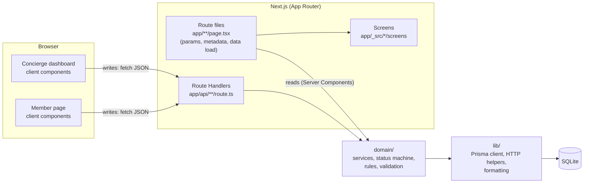

# Concierge Itinerary Proposal System

A lightweight tool for Exclusive Resorts concierges: build a curated itinerary for a member's upcoming stay, send it as a proposal, and let the member review, approve and "pay" to lock it in.

**The full loop works:** create → preview → send → member opens the link → approve → pay → confirmation, with every status visible on the dashboard.

## Contents

- [Quick start](#quick-start)
- [What it does](#what-it-does)
- [Architecture](#architecture)
- [Data model](#data-model)
- [API](#api)
- [Key decisions and trade-offs](#key-decisions-and-trade-offs)
- [Assumptions](#assumptions)
- [Known limitations](#known-limitations)
- [Stretch goals](#stretch-goals)
- [What I'd improve with more time](#what-id-improve-with-more-time)
- [Most interesting and challenging](#most-interesting-and-challenging)
- [How AI was used](#how-ai-was-used)
- [Testing](#testing)
- [Reference: scripts, database, environment](#reference-scripts-database-environment)
- [Project structure](#project-structure)
- [Tech stack](#tech-stack)

## Quick start

**Requirements:** Node.js 22 or newer (developed on Node 24) and npm. Nothing else — no `.env`, no database server.

```bash
npm install
npm run dev
```

Open the URL printed in the terminal — usually <http://localhost:3000> (Next.js picks the next free port if 3000 is taken).

| Page | URL | Who |
|---|---|---|
| Concierge dashboard | `/concierge` (`/` redirects here) | Internal staff |
| Member itinerary | `/proposal/<id>` — the link in the email, or "Open as member" on the dashboard | Members |

What happens on a fresh clone:

1. `npm install` runs `prisma generate` to build the typed database client.
2. `npm run dev` first creates `data/app.db`, applies all migrations and seeds the brief's scenario — member **James Whitfield**, his stay at **Villa Punta Mita, Mexico** (15–22 March 2027) and the concierge **Sofia Navarro**. The seed is idempotent, so it is safe on every start.
3. Next.js starts. Sent "emails" are printed to this terminal.

> SQLite runs through [`better-sqlite3`](https://github.com/WiseLibs/better-sqlite3), a native module. Prebuilt binaries cover current Node versions on macOS, Linux and Windows; on other platforms npm compiles it, which needs Python 3 and a C++ toolchain.

## What it does

**Concierge dashboard** (`/concierge`) — a plain, dense admin screen:

- The trip at the top: member, villa and destination, arrival, departure, nights, signed-in concierge.
- **Build a proposal:** give it a title, then add items in one form row — category, title (with the category's suggestions), day (only stay days), local time, price in dollars, optional description. Items appear in time order with a running total; add a note for the member.
- **Preview & send:** a preview dialog shows what the member will get; sending emails the member link (simulated: logged to the server console and stored in `sent_emails`) and shows a toast with "Copy link".
- **Save as draft and edit later:** drafts open back in the builder (`/concierge?edit=<id>`).
- **Proposals table:** title and dates, status, total, created; each row expands to show its sent/approved/paid times and every item. Drafts can be edited or sent from the row; every row can copy the member link or open it as the member.

**Member view** (`/proposal/<id>`) — a premium page in the style of a luxury listing:

- Gallery, "Your Punta Mita Itinerary", stay facts, the concierge's note, and the itinerary **day by day** ("Day 2 · Tuesday, March 16").
- A sticky summary with the total and a two-step **Approve → Pay & Lock In** stepper; on phones it becomes a fixed bottom bar.
- After paying: a **confirmation screen** that also shows on every later visit. Drafts opened by the concierge show a "Preview — not yet sent" banner and no actions.

## Architecture



- **Reads** happen in Server Components: the route file loads data through the domain services and passes plain DTOs to a *screen* component. No client-side fetching for page data; timestamps are formatted on the server, in the destination's time zone.
- **Writes** always go through the REST API (Route Handlers), never Server Actions — so the API the brief asks for is the one the UI actually exercises. After a write the client calls `router.refresh()` to re-render the server data.
- **Route handlers stay thin:** parse and validate the body (Zod) → call a service → map domain errors to HTTP in one place.
- **`domain/` vs `lib/`:** business logic lives in `domain/<entity>/` (services, status machine, rules, validation, email); infrastructure and generic helpers in `lib/`. Services start with `import "server-only"`, so importing one into a client component fails the build.
- **Thin route files, plain screens:** `app/**/page.tsx` only does Next.js work (params, metadata, `notFound()`, data loading); the UI is in `app/_src/<module>/screens`, which take DTOs as props and never touch the database or the router.
- **Next.js 16 with Cache Components:** database reads run per request (`await connection()` inside a Suspense boundary from `loading.tsx`). The build shows both pages as *Partial Prerender*: the loading skeleton is static, the data streams in.

## Data model

[`prisma/schema.prisma`](prisma/schema.prisma) is the source of truth; tables and columns are snake_case in SQLite.

| Table | Key columns | Notes |
|---|---|---|
| `members` | name, email (unique) | |
| `concierges` | name, title, email (unique), phone | Separate from members: different role and relations |
| `reservations` | member_id, destination, villa, time_zone, arrival_date, departure_date | Dates are destination-local `YYYY-MM-DD` |
| `proposals` | public_id (unique), reservation_id, concierge_id, title, status, note, created/sent/approved/paid_at | `public_id` is the unguessable id in the member link |
| `proposal_items` | proposal_id, category, title, description, scheduled_at, price_cents | `scheduled_at` is local wall time; deleted with their proposal |
| `sent_emails` | proposal_id, to_email, subject, body_preview, sent_at | Append-only log of simulated emails |

- **Status** is an enum, `draft | sent | approved | paid`; **category** is an enum of the six categories from the brief (labels and suggestions are product config in code, not a table).
- **Money** is integer cents; totals are always computed from items, never stored.
- **Audit timestamps:** every table has `created_at`; tables whose rows change also have `updated_at`.
- **Migrations** are committed in [`prisma/migrations/`](prisma/migrations). Two were hand-edited to backfill data so existing databases upgrade without a reset.

## API

JSON over Route Handlers. Bodies must be sent with `Content-Type: application/json`. A proposal's `id` is always its public id.

| Method & path | Body | Success | Errors |
|---|---|---|---|
| `GET /api/reservations` | — | `200 { reservations: [{ reservation, member }] }` | — |
| `POST /api/proposals` | `{ reservationId, title, note?, items?: Item[] }` | `201` proposal (status `draft`) + `Location` header | 400, 404, 422 |
| `GET /api/proposals` | — | `200 { proposals: [{ id, title, status, itemCount, totalCents, categories, firstDay, lastDay, items, conciergeName, …timestamps }] }` | — |
| `GET /api/proposals/:id` | — | `200` proposal with items (time order), `totalCents`, reservation, member, concierge | 404 |
| `PATCH /api/proposals/:id` | **either** `{ status }` **or** `{ title?, note?, items? }` (drafts only; `items` replaces the list) | `200` proposal | 400, 404, 409, 422 |
| `POST /api/proposals/:id/send` | — | `200 { proposal, email }` | 404, 409 |

`Item` = `{ category, title, description?, scheduledAt: "YYYY-MM-DDTHH:mm" (destination-local), priceCents }`.

**Workflow:** `draft → sent → approved → paid`, one step at a time. `PATCH { "status": "sent" }` uses the same code path as `/send`, so a sent proposal always has an email record.

**Errors** always look like `{ "error": { "code", "message", "details"? } }`:

| Status | `code` | When |
|---|---|---|
| 400 | `VALIDATION_ERROR` | Malformed JSON or a body that fails validation (`details.issues` lists each field) |
| 404 | `NOT_FOUND` | Unknown proposal or reservation |
| 415 | `UNSUPPORTED_MEDIA_TYPE` | A body sent without `Content-Type: application/json` (blocks cross-site form posts) |
| 409 | `INVALID_TRANSITION` | Status change not allowed from the current status (approve a draft, pay twice) |
| 409 | `CONFLICT` | Editing a sent proposal, sending an empty one, or a concurrent change (a double-clicked "Pay") |
| 422 | `RULE_VIOLATION` | An item scheduled outside the stay |
| 500 | `INTERNAL` | Unexpected error — logged on the server, never leaked |

Try it with `npm run dev` running:

```bash
curl -s localhost:3000/api/reservations
curl -s -X POST localhost:3000/api/proposals -H 'content-type: application/json' \
  -d '{"reservationId":1,"title":"Anniversary week","items":[{"category":"DINING","title":"Private chef dinner","scheduledAt":"2027-03-16T19:00","priceCents":120000}]}'
curl -s -X POST localhost:3000/api/proposals/<id>/send   # the email is printed in the server console
```

## Key decisions and trade-offs

1. **A strict status machine in one place.** `draft → sent → approved → paid` is defined once (`domain/proposals/status.ts`); every other transition is a `409`. The UI only shows actions that are valid for the current status.
2. **Race-safe status changes.** Updates are guarded with `WHERE status = <current>`, so two simultaneous requests (a double-clicked "Pay") can't both succeed — the second gets `409`. A test proves it, and fails if the guard is removed.
3. **Sending is atomic.** Status, `sent_at` and the email record are written in one transaction; the console "email" is logged only after it commits.
4. **Unguessable member links.** Members open `/proposal/<public id>` (21-character random id), not a sequential id, so links can't be guessed from one another.
5. **Drafts are editable, sent proposals are immutable** — enforced on the server (`409`), not only in the UI.
6. **400 vs 422 vs 409:** a malformed request is 400; a valid request that breaks a business rule (an item outside the stay) is 422; a request that conflicts with the proposal's current state is 409.
7. **Wall-clock times plus a time zone.** Items store the local time the member experiences ("dinner at 19:00 in Punta Mita") and the reservation stores the time zone. Stay-date checks are simple string comparisons with no time-zone arithmetic.
8. **The server decides who is acting.** Proposals are attributed to the current concierge on the server (`getCurrentConcierge()`, the single place a login session would plug in); clients can't send a concierge id.
9. **Two very different UIs from one app.** The concierge dashboard is a plain admin panel (one sans font, neutral colours, dense tables); the member page carries the luxury design (serif display font, gold accents, gallery). A first, more decorative dashboard was replaced after review.
10. **Prisma + SQLite instead of raw SQL.** A readable schema, typed queries and first-class migrations, at the cost of a code-generation step and no SQLite CHECK constraints (validation is done by Zod and the Prisma client instead).
11. **Optimistic where it's safe, not where money is involved.** Approving updates the page immediately (React's `useOptimistic`) and rolls back with an explanation if the server refuses; paying waits for the server, because a confirmation that might be taken back is worse than a short wait.
12. **Accessibility as part of done.** Labelled fields with linked errors, keyboard-operable dialogs and rows, deliberate focus moves after every action, `role="status"` announcements, AA contrast — checked with axe in every state and by hand (see [Testing](#testing)).

## Assumptions

- **The trip is in 2027.** The brief says March 15–22 with no year; the next such dates after today are in 2027.
- **Arrival and departure days count as part of the stay**, so an airport transfer can be scheduled on either day.
- **Times are destination-local** (`America/Bahia_Banderas` for Punta Mita, which has no daylight saving time). The dashboard shows audit times in the same zone.
- **Prices are USD estimates**, and an item's price is the **total for the whole party**, not per person (there is no party size yet).
- **One member and one reservation**, as in the brief. The data model supports more; the dashboard shows the first reservation.
- **A reservation can have several proposals** (for example a revised one). A newer proposal doesn't supersede an older one.
- **Paying requires approving first**, matching the two buttons in the brief.
- **No authentication** (see [Known limitations](#known-limitations)); the member link is the access key.
- **"Sending an email"** means a `sent_emails` row plus a console log; **"paying"** means a status change — no payment provider.
- **`GET /api/reservations` returns a list** (`{ reservations: [...] }`) rather than a single object, so supporting several reservations doesn't break the API.
- **Images are AI-generated placeholders (Google Gemini), not photos of the real property.**

## Known limitations

### Security model

There is no login; the brief asks for a member link, not accounts.

- **What the link protects:** the member page — a member can't guess another member's link from their own.
- **What it doesn't protect:** the API. `GET /api/proposals` lists every proposal id to anyone who calls it, and anyone holding an id can approve and pay. The API can't tell a member from a concierge. Links never expire.
- **Already in place:** bodies must be `application/json` (stops cross-site form posts); unexpected errors are logged on the server and never returned; the member page is `noindex`.
- **Next step:** concierge login checked in `proxy.ts` for everything under `/concierge` and the concierge endpoints, and member access through signed, expiring tokens that can only approve and pay their own proposal.

### SQLite

SQLite keeps the project to one command, but for production I'd move to Postgres (the Prisma schema and services would barely change):

- Adding a column with a non-constant default rebuilds the table and copies every row.
- One writer at a time — status updates are race-safe, but writes queue under load.
- A database file can't be deployed to serverless hosts such as Vercel.

### Workflow and data

- **No decline or "request changes"** — only `draft → sent → approved → paid`. An earlier sent proposal isn't superseded when a corrected one is sent, so it could still be approved and paid.
- **Unknown member links return HTTP 200, not 404.** The page streams (Partial Prerendering), so the status is sent before the database lookup finishes; Next adds `noindex`, and the "can't find this itinerary" content needs JavaScript to appear. A true 404 would need an extra database read in `proxy.ts` on every visit.
- **The API can't check whether a time is in the past**, because times are wall-clock times without an offset.
- **Draft edits replace the whole item list**, so item ids change on every save.

## Stretch goals

| Stretch goal (from the brief) | Status |
|---|---|
| Notes/message field shown on the member view | ✅ Done — "A note from your concierge" |
| Edit a draft before sending | ✅ Done — edit mode in the builder, conflict-safe |
| Day-by-day timeline on the member view | ✅ Done — grouped by day with day numbers |
| Animate the approval / payment confirmation | ⚠️ Partial — the confirmation fades and zooms in (respects reduced motion) |
| Optimistic UI updates | ✅ Done for **Approve** — the stepper moves on at once and rolls back if the server refuses. **Pay is deliberately not optimistic:** "locked in" must never show for a payment that might still fail |
| Multiple members / reservations in the UI | ❌ Not done — the data model and API support it; the dashboard shows one trip |

## What I'd improve with more time

The full list, with what exists today and why each item was deferred, is in [`docs/BACKLOG.md`](docs/BACKLOG.md). The most important:

- **Security:** concierge login and expiring member tokens (see [Security model](#security-model)); validate environment variables at startup once there are secrets.
- **Workflow:** decline / request changes; supersede earlier proposals when a corrected one is sent; per-item confirmation after payment (the confirmation screen promises the concierge will confirm every booking).
- **Data model:**
  - party size and per-person pricing;
  - item duration and location, to catch overlapping items;
  - member preferences such as dietary needs;
  - destinations and villas as tables (the time zone belongs to the place, not the booking);
  - payments and status history as records, with who did what;
  - currency per proposal.
- **Production:** Postgres; a real email provider with delivery status; photos in object storage managed from the dashboard; absolute links from a configured app URL; pagination.
- **UX:** multiple reservations in the dashboard; optimistic sending from the proposals table; a gallery carousel; translations (dates and money already go through `Intl`).
- **Quality:** automated accessibility checks in CI (`@axe-core/playwright`) and end-to-end tests of the full loop; component tests next to components.

## Most interesting and challenging

- **Making the workflow trustworthy, not just functional.** The happy path is easy; the interesting part was what happens when two things happen at once. A double-clicked "Pay" must not pay twice, a draft edited in one tab and sent from another must not silently lose changes, and a "sent" proposal must always have its email. Guarded updates, one transaction for sending and a concurrency test that fails without the guard made those guarantees concrete.
- **Next.js 16's new defaults.** Cache Components changes how data loading works: a database read without `connection()` was silently prerendered at build time (I verified it), my error-handling wrapper swallowed Next's internal "stop prerendering" signal until I used `unstable_rethrow`, and streamed pages can't return a 404 status. Reading the framework's bundled docs before writing code paid off more than once.
- **Accessibility you can only find by using it.** Automated checks (axe) reported zero violations in every state, yet a real walkthrough found six problems — the most important one: after paying, the confirmation appeared at the top of the page while the member was scrolled down at the summary card, so they never saw it. Every fix was about *where focus goes next* when the control you just used disappears.
- **Two audiences in one product.** The same data has to feel efficient to a concierge and premium to a member; keeping one design system but two clearly separate treatments took a deliberate rework of the dashboard.

## How AI was used

I built this with Claude Code, working phase by phase and stopping for review after each step. The full log — what the AI produced, what I changed or rejected, and how each step was verified — is in [`docs/AI_NOTES.md`](docs/AI_NOTES.md). In short:

- **I set the direction, AI did most of the typing.** The stack, phases and domain rules came from my `CLAUDE.md`; the AI proposed assumptions and challenged decisions before writing code, and I accepted, adjusted or rejected them.
- **My review changed the design several times:** Drizzle → Prisma, a separate concierge entity, `domain/` vs `lib/`, thin route files with screens, `/concierge` vs `/proposal` URLs, the admin-panel rework of the dashboard, react-hook-form for the item form, proposal titles, expandable rows, and several layout fixes from my screenshots.
- **Everything was verified, not assumed:** tests (including a concurrency test checked by deliberately breaking the code), `curl` against every endpoint and error case, production builds, browser walkthroughs driven through Claude in Chrome, axe in every UI state, and a clean clone of the public repo.
- **The AI made mistakes, and the process caught them:** a wrong claim about Prisma 7's behaviour (corrected in the README), an error wrapper that broke Next's prerendering, a CSS change that would have half-darkened the UI, and a contrast issue it introduced itself (caught by axe). A devil's-advocate audit after the API phase found and fixed a cross-site request issue and an implicit "first row" assumption.
- **Guardrails stayed on:** a destructive database reset was run only after my explicit consent; credentials were never typed into the chat; third-party packages and an installed skill were read before use; new dependencies were pinned to releases at least two weeks old.

## Testing

```bash
npm test          # 97 tests
npm run lint
npm run typecheck
npm run build
```

- **Unit tests:** status machine, stay-date rule, totals, formatting, request validation, and the HTTP layer (each error code's status, the content-type check, no leaked internals on 500s).
- **Service tests on real SQLite:** the full create → send → approve → pay loop, draft editing, titles and derived fields, error cases, and a concurrency test proving two simultaneous approvals can't both succeed. A global setup migrates one template database per run; each test works on its own copy, so tests never touch `data/app.db`.
- **Manual and browser checks** (recorded in [`docs/AI_NOTES.md`](docs/AI_NOTES.md)): every endpoint and error case with `curl`; the full loop clicked through in Chrome on production builds; axe-core (WCAG 2.0–2.2 A/AA) in every UI state with zero violations; keyboard-only flows; phone and tablet widths; and a final clean clone of the public repository following only this README.

## Reference: scripts, database, environment

### Scripts

| Command | What it does |
|---|---|
| `npm run dev` | Set up the DB (migrate + seed), then start the dev server |
| `npm run build` / `npm start` | Production build / serve it (`start` also runs DB setup first) |
| `npm run lint` | ESLint |
| `npm run typecheck` | Generate Next.js route types, then `tsc --noEmit` |
| `npm test` | Vitest tests |
| `npm run db:setup` | Apply pending migrations and seed |
| `npm run db:migrate` | Regenerate the client, then create and apply a new migration after editing the schema (dev only) |
| `npm run db:seed` | Re-run the seed (idempotent) |
| `npm run db:reset` | ⚠️ Delete **all** data, re-apply migrations, re-seed (dev only) |
| `npm run db:studio` | Browse the database in Prisma Studio |
| `npm run images:optimize` | Convert new PNG/JPEG files in `public/images` to resized WebP and delete the originals |

### Database tasks

**Change the schema**

```bash
# 1. edit prisma/schema.prisma
npm run db:migrate -- --name describe_the_change
# creates prisma/migrations/<timestamp>_describe_the_change/migration.sql and applies it;
# the script runs `prisma generate` first, because Prisma 7's `migrate dev` no longer does
```

Commit the new migration folder with the schema change. Don't edit or rename a migration once it has been applied anywhere — Prisma checks them by name and checksum.

**Start over with a clean database:** `npm run db:reset` (⚠️ deletes every row; development only — in Prisma 7, `migrate reset` no longer seeds on its own, so the script chains the seed). Deleting the file works too: `rm -rf data && npm run db:setup`.

### Environment variables

All optional — the defaults work out of the box. Put overrides in `.env.local` (git-ignored).

| Variable | Default | Purpose |
|---|---|---|
| `DATABASE_URL` | `file:./data/app.db` | SQLite file used by the Prisma CLI and the app |
| `CURRENT_CONCIERGE_EMAIL` | `sofia.navarro@example.com` (the seeded concierge) | Which concierge new proposals are attributed to, until there is a login |

## Project structure

```
app/                         Next.js App Router
  concierge/                 /concierge route (thin: loads data, renders a screen)
  proposal/[id]/             /proposal/:id route
  api/                       Route Handlers (thin: validate → service → map errors)
  _src/                      UI (private folder, not routed)
    common/                  shared components (incl. shadcn/ui), screens, utils
    concierge/               dashboard components, screens, utils
    member/                  member view components, screens
domain/                      business logic, one folder per entity
  proposals/                 service, status machine, rules, validation, email, categories
  reservations/  concierges/
  errors.ts                  DomainError (business-rule failures)
lib/                         infrastructure and generic helpers
  api/  db/  format.ts       HTTP helpers, Prisma client, money/date formatting
prisma/                      schema, migrations, seed
public/images/               gallery and confirmation images (WebP)
scripts/                     image optimisation
tests/                       Vitest tests, grouped by module
docs/                        AI usage notes, backlog of deferred decisions
```

Every component is a folder named after it with an `index.tsx` (`<module>/components/<Name>/index.tsx`), so a test can sit next to it.

## Tech stack

Next.js 16 (App Router, Cache Components) · React 19 · TypeScript (strict) · Tailwind CSS v4 · shadcn/ui (Radix) · react-hook-form · Zod · Prisma 7 + SQLite (`better-sqlite3`) · Vitest
